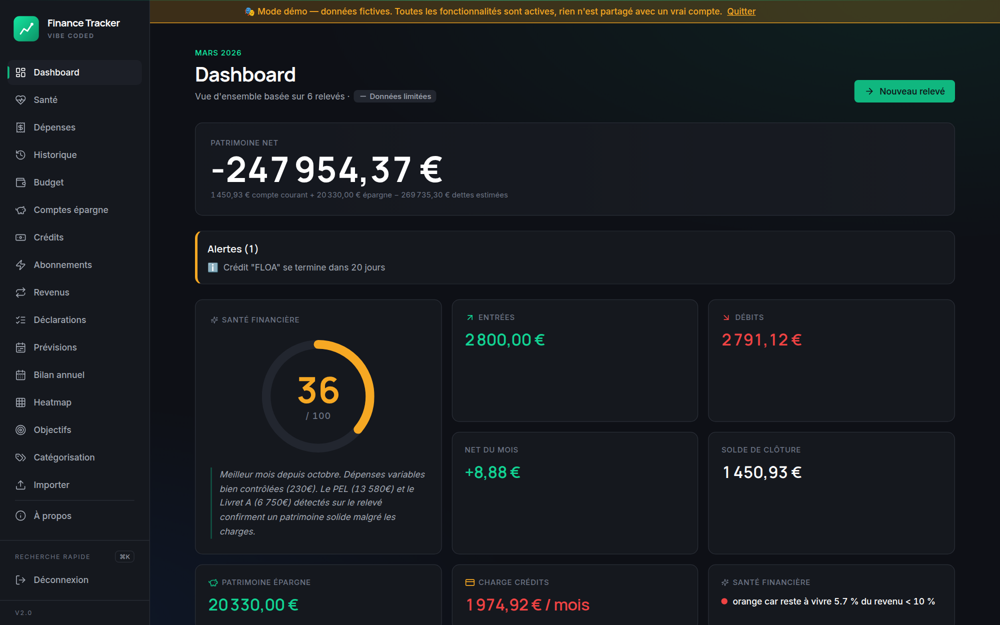
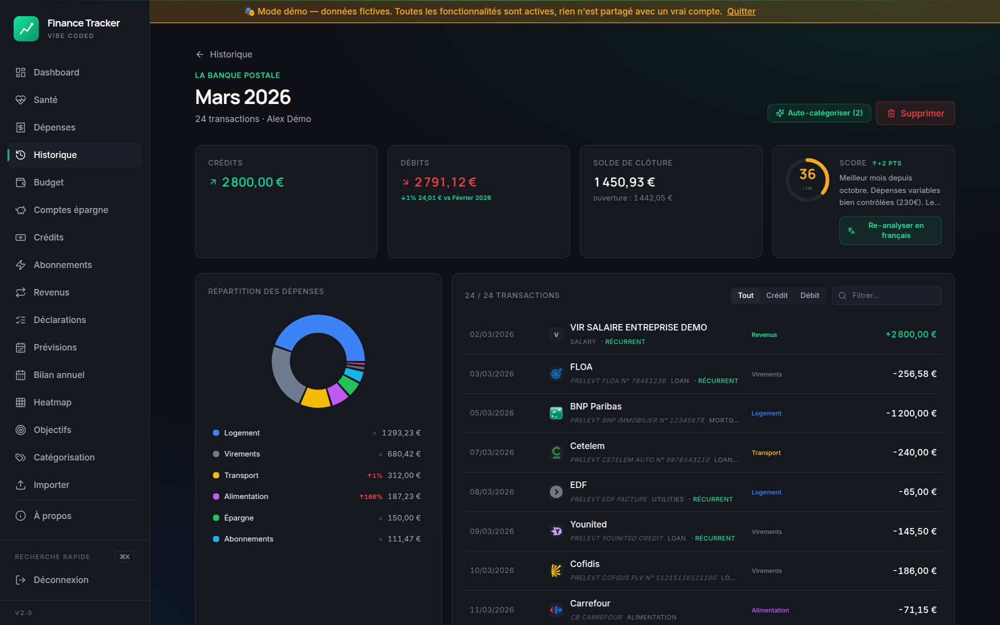
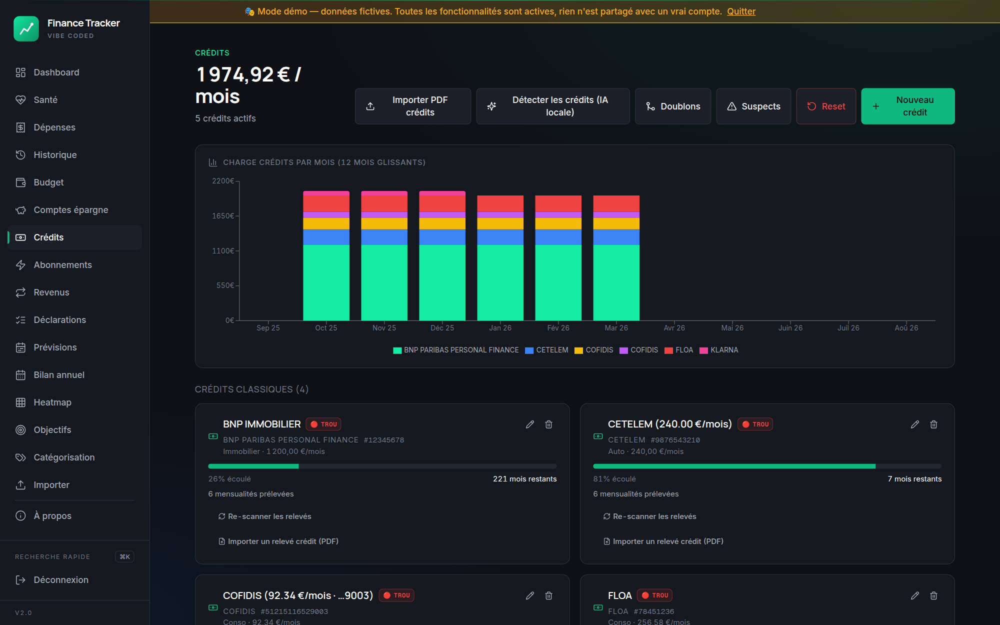
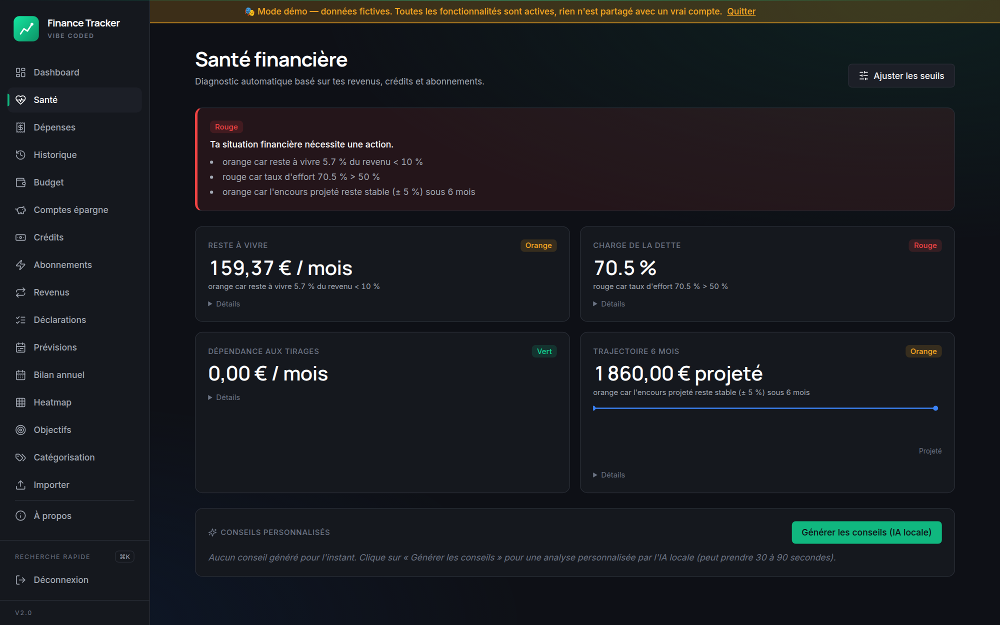
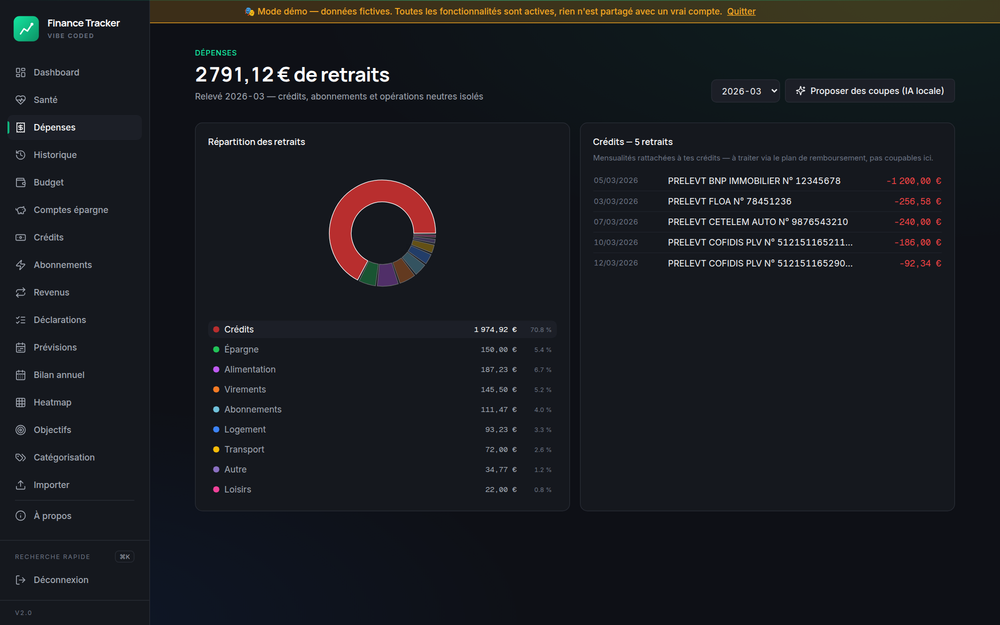
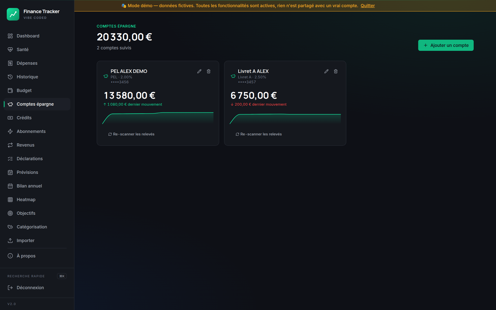
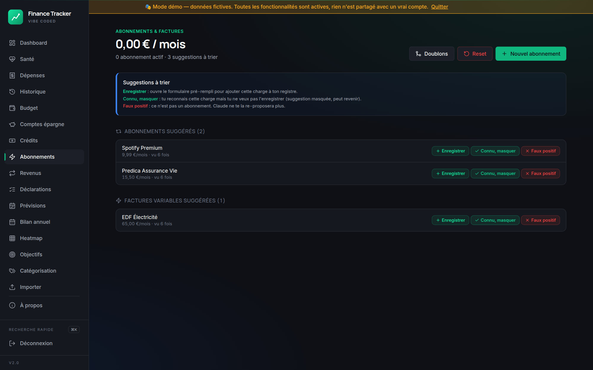
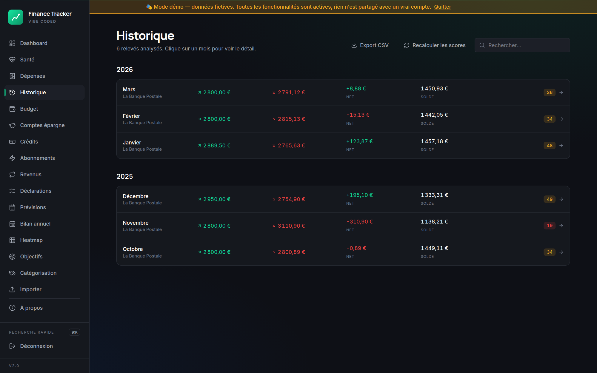
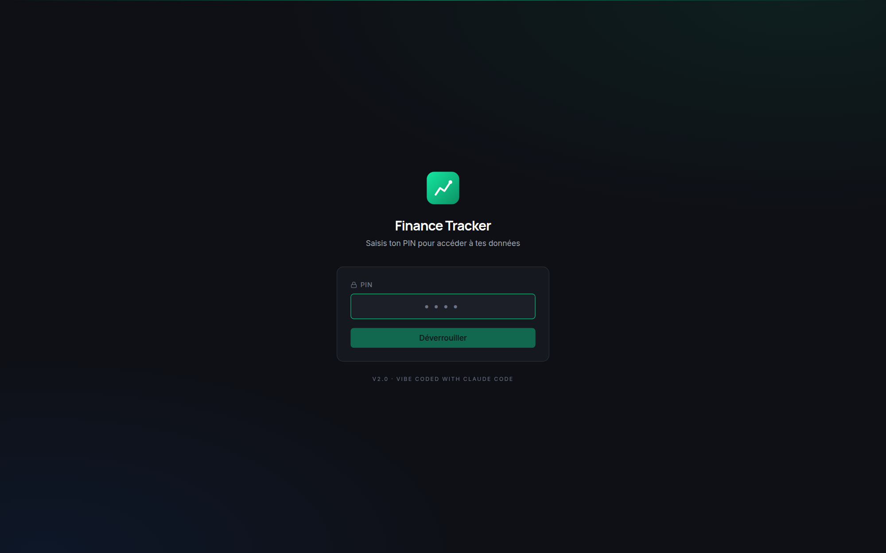

# Finance Tracker

[](https://claude.com/claude-code)
[](https://chat.openai.com)
[](https://react.dev)
[](https://nestjs.com)
[](LICENSE)

> Analyse tes relevés bancaires PDF avec Claude, suis ton score de santé financière, configure des budgets et des prévisions. Tout local, rien ne sort de ta machine.



> Captures prises en **mode démo** (jeu de données fictives 6 mois). L'app embarque un mode démo activable d'un clic, pour explorer toutes les fonctionnalités sans toucher à un vrai compte bancaire.

### Aperçu

| | |
|---|---|
|  |  |
| **Détail d'un relevé** — répartition catégorielle, transactions taggées + récurrentes, commentaire Claude | **Crédits** — classiques (barre temporelle), revolving (jauge), suggestions Claude à valider |
|  |  |
| **Santé financière** — reste à vivre, charge de dette, dépendance aux tirages, trajectoire 6 mois + conseils par IA locale (Ollama) | **Dépenses** — camembert drill-down avec crédits/abonnements/épargne isolés, coupes proposées par l'IA locale |
|  |  |
| **Comptes épargne** — PEL, Livret A, sparkline + recalage auto à chaque import | **Abonnements** — détectés par Claude, à trier (connu / faux positif) |
|  |  |
| **Historique** — relevés analysés groupés par année, score par mois | **Login** — PIN guard simple (Bearer token) pour les déploiements perso |

<sub>Captures régénérables via `node docs/screenshots/capture.mjs <PIN> docs/screenshots` (Playwright, app démarrée en local, mode démo).</sub>

## Pourquoi

Dev Java/web depuis 2005, j'ai voulu voir jusqu'où on pouvait pousser une collaboration humain ⇄ IA sur un stack que je ne pratique pas en prod : **NestJS + React 18 + Tailwind + shadcn**. Cette appli a été co-construite avec [Claude Code](https://claude.com/claude-code) (le code) et [ChatGPT](https://chat.openai.com) (logo + premières maquettes UX).

Mon rôle : tracer la vision, valider les choix, repérer ce qui cloche.
Le rôle de Claude : poser le code, expliquer, itérer.

## Fonctionnalités

- **Import PDF multi-fichier** (jusqu'à 12 relevés en une fois, 20 Mo maximum chacun) — analyse via Claude (Sonnet 5.5) en two-phase tool-use, avec garde-fou sur le type de document (un relevé de crédit ne peut pas écraser un relevé bancaire)
- **Import de relevés : barre d'actions collante** (L111, `frontend/src/routes/upload.tsx`) — la barre « N fichiers · Vider · Analyser » (`data-actions-bar`) est `sticky` en bas de l'écran : avec 12 fichiers le bouton « Analyser » reste visible sans défiler (il était à y = 1212 px). Au téléphone elle se cale à `4rem + env(safe-area-inset-bottom)` du bas, juste au-dessus de la barre de navigation fixe (qui la recouvrait) ; dès `lg` elle colle au bord. Elle passe à la ligne quand « Analyse en cours… fichier k / N » ne tient pas. L114 : la barre est un frère de la section de la liste, pas son enfant — un `sticky` ne quitte jamais son parent, donc avec un encadré de refus (section qui commence sous la navigation fixe) elle restait bloquée sur « Analyser » ; mesuré au navigateur à 390×844, 390×664 et 320×568 (le centre du bouton reçoit le clic à chaque défilement). Tests : `routes/upload-sticky-bar.test.tsx` (R5, R6)
- **Import de relevés : suivi pendant l'analyse** (L110, `frontend/src/lib/upload-progress.ts` + `routes/upload.tsx`) — le serveur analyse les fichiers un par un et journalise chacun quand il le prend : `fileProgress` lit cet historique (seuls les journaux apparus depuis l'envoi comptent, rapprochés des fichiers par nom, dans l'ordre) et la liste affiche pour chaque fichier « En attente », « Claude analyse… » (un seul à la fois) ou « Fait », avec « fichier k / N » sur le bouton et dans la région de statut. Un fichier ignoré parce que son mois existe déjà laisse un journal de statut `skipped` (L113) : il passe « Fait » et fait avancer « fichier k / N » au lieu de rester « En attente » jusqu'au bilan. L'historique des imports est relu toutes les 2 s pendant un envoi (`useImportLogs`), pour que le premier fichier apparaisse sans attendre le cycle lent de 10 s. « Vider » et « Parcourir » sont désactivés pendant l'analyse et un dépôt de fichiers y est ignoré : la liste suivie ne change plus. Tests : `lib/upload-progress.test.ts`, `routes/upload-progress.test.tsx`, `lib/import-logs-polling.test.tsx`
- **Import de relevés : résultat fichier par fichier** (L109, `frontend/src/lib/upload-report.ts` + `routes/upload.tsx`) — quand le serveur refuse tout le lot (422), `failuresFromUploadError` reprend le `errors[]` du serveur : chaque fichier est listé avec sa raison (plus de faux fichier « upload »). Une erreur serveur (5xx) est écrite en français (« Le serveur a rencontré une erreur… ») et attribuée à chacun des fichiers envoyés ; toute autre erreur garde son message. Les fichiers ignorés parce que leur mois existe déjà sont nommés dans le résultat, avec un lien « déjà importé : <mois> » vers le relevé (`skippedMonthLabel`, identifiant `AAAA-MM`). Tests : `lib/upload-report.test.ts`, `routes/upload-report.test.tsx`
- **Import de relevés : contrôle à la sélection** (L108, `frontend/src/lib/upload-files.ts` + `routes/upload.tsx`) — à la sélection comme au glisser-déposer, `selectStatementFiles` écarte, avec le nom et la raison de chacun (encadré `role="alert"` « N fichiers non ajoutés »), les fichiers qui ne sont pas des PDF, ceux de plus de 20 Mo (taille affichée), les doublons (même nom et même taille) et les excédents au-delà de 12 ; les fichiers valides restent dans la liste. Mêmes limites que le serveur (`FilesInterceptor`, 20 Mo, 12), mais refusées avant l'envoi : un PDF de 25 Mo ne fait plus échouer tout le lot. La limite de 20 Mo figure dans la consigne de la page ; à 12/12, « Parcourir » est désactivé et le texte l'explique. Tests : `lib/upload-files.test.ts`, `routes/upload-limits.test.tsx`
- **Import de relevés : contrôle à la sélection affiné** (L112, `frontend/src/lib/upload-files.ts` + `routes/upload.tsx`) — `isPdf` reprend le test du `fileFilter` serveur (type MIME `application/pdf` seul) : un `.pdf` sans type MIME est écarté à la sélection (raison « type PDF non reconnu par le navigateur… ») au lieu de faire répondre 400 au lot entier. La taille d'un fichier refusé pour dépasser 20 Mo est arrondie au supérieur (20 Mo + 1 octet → « 20,1 Mo », jamais « 20,0 Mo »). Quand la sélection porte la liste à 12/12 alors que « Parcourir » avait le focus, le focus passe au premier « Retirer » (WCAG 2.4.3). Tests : `lib/upload-files.test.ts`, `routes/upload-limits.test.tsx` (R9)
- **Import de relevés : suivi et affichage justes** (L113) — (1) `backend/src/common/pdf-upload-filter.ts` : le `fileFilter` multer commun (analyse, re-analyse, trois imports de crédits) rétablit l'UTF-8 de `originalname` (multer le relit en latin1 : « relevé_août ») avant tout stockage ; l'historique relit aussi les anciens journaux abîmés (`fromLatin1`). (2) Un fichier sauté parce que son mois est déjà importé est journalisé (`status: 'skipped'`, relevé existant) : « Fait » dans le suivi, « déjà importé : Mars 2026 » dans l'historique. (3) `components/install-prompt.tsx` : dès `lg` la bannière d'installation se cale à droite de la barre latérale (`left-[256px]`) au lieu du coin bas droit, où elle recouvrait « Analyser » à 1440 px. (4) `lib/upload-report.ts` : un 502/503 ne dit plus « n'a pas été importé » (l'analyse a pu continuer : consulter l'historique) ; un 413 se lit « 20 Mo maximum par fichier » ; aucun « HTTP n » brut n'est montré. Tests : `pdf-upload-filter.spec.ts`, `analysis.controller.spec.ts`, `lib/upload-report.test.ts`, `lib/upload-progress.test.ts`, `routes/upload-progress.test.tsx`, `components/install-prompt.test.tsx`
- **Import de relevés au lecteur d'écran** (L107, `frontend/src/routes/upload.tsx`) — chaque croix de la liste est un bouton « Retirer <nom du fichier> » ; après un retrait le focus passe au « Retirer » suivant (sinon au précédent, sinon à « Parcourir » ; « Vider » y envoie aussi le focus) ; au clic sur « Analyser » le focus va à la région `role="status"` (le bouton se désactive puis la liste disparaît). Cette région annonce l'analyse en cours, le bilan (« Analyse terminée : N importé, N ignoré, N échec ») et « Connexion fermée » ; chaque échec est un `role="alert"`. Tests : `routes/upload-a11y.test.tsx`
- **Page Épargne : boutons nommés** (L116, `frontend/src/routes/savings.tsx`) — les boutons crayon et corbeille de chaque carte portent `aria-label` « Modifier <compte> » / « Supprimer <compte> » et la croix de la fenêtre de saisie « Fermer » (icônes `aria-hidden`), comme `loans.tsx` (WCAG 4.1.2, 2.4.6). Aucun changement visuel. Test : `routes/savings.test.tsx`
- **Page Crédits : boutons nommés** (L132, `frontend/src/components/loans/{classic,revolving,installment,closed}-card.tsx`, `loan-form.tsx`) — les boutons crayon et corbeille de chaque carte (classique, renouvelable, N×, terminé) portent `aria-label` et `title` « Modifier <crédit> » / « Supprimer <crédit> », et la croix du formulaire « Fermer » (WCAG 4.1.2). Aucun changement visuel. Test : `components/loans/loan-card-actions.test.tsx`
- **Diagnostic de santé financière** — 4 indicateurs à seuils configurables (reste à vivre, charge de dette, dépendance aux tirages revolving, trajectoire d'encours à 6 mois) + **conseils personnalisés par IA locale** (Ollama, rien ne sort de la machine)
- **Épargne : fenêtre de saisie accessible** (L117, `frontend/src/routes/savings.tsx`) — la fenêtre Nouveau compte / Modifier le compte est une vraie modale, sur le modèle de celle des Déclarations : rôle `dialog` + `aria-modal` nommée par son titre, focus sur Nom à l'ouverture, Tab bouclé, Échap ferme (sauf s'il vient de la palette ⌘K ouverte par-dessus), focus rendu au bouton d'origine (WCAG 2.4.3, 4.1.2). Le voile défile, la carte est bornée à `100dvh − 2rem` avec titre et × collés en haut, et les champs passent sur une colonne sous 640 px : titre, × et « Enregistrer » restent atteignables à 320×568 et à 200 % de texte (WCAG 1.4.4, 1.4.10). Le comportement clavier est partagé avec les Déclarations dans `hooks/use-modal-dialog.ts`. Test : `routes/savings-modal.test.tsx`
- **Crédits : fenêtres au clavier** (L133, `frontend/src/components/dialog.tsx`) — le formulaire de crédit, Doublons et Suspects passent par un composant `Dialog` commun (au-dessus de `hooks/use-modal-dialog.ts`) : rôle `dialog` + `aria-modal` nommée par son titre (`aria-describedby` pour l'aide), focus sur le premier champ à l'ouverture (sans champ, sur la fenêtre elle-même, jamais sur une action destructive), Tab / Maj+Tab bouclés (Maj+Tab depuis la fenêtre ne sort pas), Échap ferme (sauf s'il vient de la palette ⌘K ouverte par-dessus), clic sur le voile ferme, focus rendu au bouton d'origine, × nommé « Fermer » (WCAG 2.4.3, 4.1.2). Le voile défile, le panneau part du haut (L134). Tests : `components/dialog.test.tsx`, `components/loans/loan-form.test.tsx`, `components/loans/loans-dialogs.test.tsx`
- **Épargne : échec de chargement** (L118, `frontend/src/routes/savings.tsx`) — si `GET /api/savings-accounts` échoue, la page affiche « Impossible de charger les comptes épargne » avec **Réessayer** (désactivé pendant le rechargement), sans total « 0,00 € », sans « Aucun compte épargne déclaré » ni bouton « Ajouter un compte » ; un rafraîchissement qui échoue garde les comptes déjà chargés (Nielsen 1, 9). Test : `routes/savings-errors.test.tsx`
- **Épargne : taux au format français** (L121, `frontend/src/routes/savings.tsx`, `lib/utils.ts`) — le taux de chaque carte s'écrit « 2,00 % » (`formatRatePercent`, fr-FR, comme les montants) au lieu de « 2.00% », et le champ « Taux d'intérêt (%) » est arrondi au centième (`ratePercentInput`) : 0,017 s'affiche 1,7 et non « 1.7000000000000002 » (idem 0,0175, 0,022). Tests : `lib/utils.test.ts`, `routes/savings-modal.test.tsx`
- **Épargne : courbe de chaque carte** (L119, `frontend/src/routes/savings.tsx`, `lib/savings-curve.ts`) — la courbe des 12 derniers mois n'affiche plus les mois antérieurs à l'ouverture du compte (le plus ancien de la date du solde initial et du premier mouvement), où le solde calculé valait 0 € : elle commence au mois d'ouverture, avec moins de deux mois restants aucune courbe. Au-dessus, « 12 derniers mois » (rien d'écarté) ou « Depuis <mois année> » ; dessous, le solde de début et celui de fin ; le graphique est un `role="img"` dont l'`aria-label` résume « Solde de <compte> : X en <mois>, Y en <mois> » (WCAG 1.1.1, Nielsen 2). Corriger après coup la date ou le montant du solde initial (L124, `SavingsService.update`) recale le mouvement « initial » créé à l'ouverture (le solde courant bouge du même écart) : la courbe suit la nouvelle date d'ouverture. Limite : l'historique du backend part de 0 + mouvements (dont ce mouvement « initial »). Tests : `lib/savings-curve.test.ts`, `routes/savings.test.tsx`
- **Épargne : dernier mouvement nommé et daté** (L120, `frontend/src/routes/savings.tsx`, `lib/savings-last-movement.ts`) — sous le solde, la ligne « ↓ 200,00 € dernier mouvement » (rouge, sans date ni nature, lue sur le dernier élément du tableau) devient « Ajustement au relevé · 30/09 : −200,00 € » : nature d'après la source du mouvement (Versement détecté, Intérêts, Mouvement manuel, Ajustement au relevé), date jj/mm, montant signé. Le dernier mouvement est le plus récent par date, solde initial exclu ; un ajustement au relevé (`bank-extract`) recale le solde et reste en ton neutre, versement en vert, retrait en rouge ; un mouvement `detected` de montant négatif s'intitule « Retrait détecté · 30/09 : −50,00 € » et non « Versement détecté » (L125) ; sans mouvement ou à 0 €, rien n'est affiché (Nielsen 1, 2). Tests : `lib/savings-last-movement.test.ts`, `routes/savings.test.tsx`
- **Épargne : intérêts datés au dernier jour réel du mois** (L127, `backend/src/modules/auto-sync/auto-sync.service.ts`, `maybeAddInterest`) — le mouvement d'intérêts estimé porte le dernier jour calendaire du mois anniversaire (28/29 février, 30 avril/juin/septembre/novembre, 31 sinon), plus un « -31 » fixe qui donnait « 31/06 » ou « 31/02 » dans la liste L123 ; la même date borne la reconstruction du solde en rejeu. Les intérêts déjà enregistrés ne sont pas redatés. Tests : `auto-sync.service.spec.ts` (février bissextile ou non, avril, juin, septembre, novembre, mois de 31 jours)
- **Épargne : liste repliable des mouvements** (L123, `frontend/src/routes/savings.tsx`, `lib/savings-last-movement.ts`) — sous la courbe de chaque carte, le bouton « Mouvements (n) » (`aria-expanded`, `aria-controls`) déplie la liste des mouvements du compte, du plus récent au plus ancien (à date égale, le dernier du tableau d'abord), solde initial compris : date jj/mm/aaaa, nature (mêmes libellés que la ligne « dernier mouvement » : Solde initial, Versement / Retrait détecté, Ajustement au relevé, Intérêts, Mouvement manuel), montant signé (vrai « − ») aligné à droite en chiffres tabulaires, note en texte secondaire (L126 : la note du backend est nettoyée à l'affichage — préfixe « Auto: » retiré, nature non répétée dans la note d'intérêts « 2026 (2,50 %) » avec le taux à la française — L128 : ce nettoyage de « Intérêts » en tête et du taux ne vaut que pour la source `interest`, un versement détecté noté « Auto: Intérêts créditeurs LDDS » s'affiche « Intérêts créditeurs LDDS » —, L129 : sur un ajustement au relevé, la redite en tête (« Solde recalibré depuis le relevé », « Ajustement solde réel depuis relevé », tiret ou parenthèses autour du reste) est retirée et le reste utile gardé avec sa majuscule — « 6 750 vs 6 800 calculé », « Écart dû aux intérêts capitalisés » —, les soldes « a vs b » à la française ; une note réduite à la redite est masquée). Au téléphone, deux rangées par mouvement (date et montant, puis nature et note). Repliée par défaut ; sans mouvement, pas de bouton ; en-tête inchangé. La ligne « Solde initial » n'affiche jamais sa note (redondante avec la nature) ; le nom accessible du bouton est « Mouvements (n) de <compte> » (il commence par le libellé visible, WCAG 2.5.3). La grille garde ses colonnes mais porte `items-start` : les cartes d'une même rangée ne sont plus étirées à la hauteur de la plus haute, si bien qu'une carte dépliée ne gonfle pas sa voisine (ne pas retirer `items-start` pour « restaurer » l'état d'origine). Tests : `lib/savings-last-movement.test.ts`, `routes/savings.test.tsx`
- **Page Dépenses** — répartition des retraits du mois avec crédits/abonnements/épargne/opérations neutres isolés d'office, drill-down par catégorie, et **coupes proposées par l'IA locale** sur 3 mois (abonnement / achat ponctuel / autre)
- **Suivi des crédits de bout en bout** — import batch des relevés de crédit ET plans d'amortissement (type de document auto-détecté, rattachement par n° de contrat), tirages sur réserves renouvelables, restant dû officiel prioritaire sur l'estimation
- **Détection LLM locale des crédits et paiements en N fois** (Klarna, PayPal 4×…) — le LLM propose, un validateur déterministe vérifie (1 débit/mois, jour stable, fraîcheur), l'humain accepte
- **Score de santé financière** sur 100 (5 dimensions : épargne, contrôle, dette, cash flow, irrégularité)
- **Catégorisation auto** des transactions (logement, alimentation, etc.) avec sous-catégorie + niveau de confiance ; libellés français partout, y compris sous les champs de saisie brute (déclarations, changement de catégorie) ; la recherche du détail d'un relevé couvre catégorie et sous-catégorie, sans tenir compte des accents
- **Dictionnaire de marchands** (L75) — livré avec le code (`backend/src/modules/category-rules/merchant-dictionary.ts`, version 1) : Carrefour, Leclerc, Lidl, Uber Eats → Alimentation ; SNCF, TotalEnergies, Vinci, Uber → Transport ; Netflix, Free, Orange → Abonnements. Appliqué à l'analyse et à la ré-analyse d'un relevé, **débits seulement**, avec la priorité *règle utilisateur > dictionnaire > catégorie de Claude* ; les libellés sont normalisés à la volée (majuscules, accents, préfixes CB / PAIEMENT CB / PRLV / VIR…, dates et mots à chiffre retirés ; les libellés stockés ne sont jamais réécrits) et l'enseigne doit former des mots entiers (« FREEDOM » n'est pas Free) ; un organisme de crédit ou d'épargne homonyme est écarté par des mots d'exclusion (« CARREFOUR BANQUE », « ORANGE BANK », « DUTY FREE » ne sont pas reconnus : champ `unless` des entrées ; un dernier mot tronqué de 4 lettres au moins, comme « CARREFOUR BANQU », compte aussi). Quand le dictionnaire change la catégorie, la sous-catégorie donnée par Claude est vidée. Chaque passage écrit le log `Merchant dictionary v1: <n> transaction(s) recategorized` (la version n'est pas écrite dans les relevés). Le rejeu des règles (`replayAll`) n'applique jamais le dictionnaire. L'aperçu d'auto-catégorisation (`POST /api/auto-categorize/:id/preview`) résout les enseignes connues sans appeler Claude (suggestions de confiance 1, champ `source` : `dictionary` ou `claude`), et propose pour elles le même motif (mots de l'enseigne)
- **Mémoriser pour ce marchand** (L75) — `PATCH /api/statements/:id/transactions/:txId/category` accepte `memorizeMerchant: true` (le booléen seul ; `createRule` reste prioritaire s'il est aussi vrai) : la catégorie est appliquée et une règle utilisateur est créée sur les mots de l'enseigne que le dictionnaire reconnaît dans le libellé (ex. `\bCARREFOUR\b` pour « RETRAIT DAB 12/03 CARREFOUR »), sinon sur toute la clé normalisée (ex. `\bRESTAURANT[^A-Za-z0-9]+LE[^A-Za-z0-9]+RECAMIER\b`), y compris quand la catégorie choisie contredit celle du dictionnaire (« PRLV VINCI IMMOBILIER LOYER » remis en Logement mémorise `VINCI IMMOBILIER LOYER`, pas `VINCI`, pour ne pas détourner les péages) — chaque mot borné, jamais un fragment de la clé, sans modifier une règle existante — une règle déjà gagnante avec le même résultat est réutilisée, sinon la nouvelle passe au-dessus (priorité 100 ou 1 + la plus haute règle qui reconnaît le libellé). `replayAll` rejoue la règle sur les autres relevés. Libellé sans marchand ou motif ne reconnaissant pas le libellé brut : catégorie appliquée, pas de règle, `ruleSkipped` (`merchant-key-empty` / `pattern-too-short` pour un motif d'un seul mot de moins de 4 lettres / `pattern-no-match`). Le panneau « Catégoriser » propose trois choix de règle exclusifs (boutons radio) : « Mémoriser pour « <mots du motif> » » (présélectionné, c'est lui qui envoie `memorizeMerchant`), « Règle avec un motif à saisir » (`createRule` et motif regex libre) et « Aucune règle ». La mémorisation est grisée, avec sa raison affichée, quand aucune règle ne serait créée : clé de marchand vide, motif d'un seul mot de moins de 4 lettres, ou mots du motif absents tels quels du libellé brut (accent, chiffres intercalés).
- **Détail d'un relevé au téléphone** (L78) — sous 768 px, chaque transaction (`frontend/src/components/tx-row.tsx`) tient sur deux rangées : libellé (avec « · récurrent », qui passe à la ligne au lieu d'être tronqué) et montant en entier à droite, puis date et catégorie ; dès 768 px, la ligne à 12 colonnes d'origine. Depuis L79, à toute largeur, le titre (libellé brut quand aucun marchand n'est reconnu) et la sous-ligne passent à la ligne au lieu d'être rognés par une ellipse : « · récurrent » n'est jamais coupé
- **Crédits au téléphone** (L96) — la rangée d'actions de l'en-tête de `/loans` (Importer PDF crédits, Détecter les crédits, Doublons, Suspects, Reset, Nouveau crédit ; `frontend/src/routes/loans.tsx`) passe à la ligne quand la largeur manque, au lieu de s'étendre sur 722 px et d'élargir la page à 738 px à 390 px (défilement horizontal) ; dès 640 px le titre (« X € / mois », sur une ligne) et la rangée sont empilés (côte à côte, les six boutons ~873 px ne tiennent à aucune largeur : le contenu est plafonné à ~1136 px), la rangée tient sur une ligne à 1440 px et passe à la ligne sous ~900 px de contenu ; au passage, les trois boutons d'une suggestion de crédit (`suggestions-banner.tsx`) passent à la ligne à 320 px au lieu d'élargir la page à 357 px
- **Formulaire de crédit sur petit téléphone** (L134, `frontend/src/components/loans/loan-form.tsx`) — le voile de la fenêtre « Nouveau crédit » / « Modifier le crédit » ne centre plus le panneau (`items-center`, qui coupait le haut à −66 px et poussait Enregistrer sous l'écran à 320×568) : comme Doublons et Suspects, il aligne le panneau en haut (`items-start`), défile (`overflow-y-auto`) et laisse une marge verticale (`my-8`), titre et Enregistrer restent atteignables (WCAG 1.4.10). Test : `components/loans/loan-form.test.tsx`
- **Crédits : dates du formulaire lisibles à 320 px** (L144, `frontend/src/components/loans/loan-form.tsx`) — « Date début » et « Date fin » (crédit classique) s'empilent sur une colonne sous 400 px (`grid-cols-1 min-[400px]:grid-cols-2`) au lieu de se partager 2 × ~125 px, où le champ coupait l’année (« 07/05/202 »), y compris à 360 px (127 px par champ) ; côte à côte dès 400 px. Test : `components/loans/loan-form.test.tsx` (« dates à 320 px »)
- **Crédits : mois sans relevé dans le graphe des mensualités** (L143, `frontend/src/components/loans/loans-monthly-chart.tsx`, `routes/loans.tsx`) — une ligne visible sous le graphe « Charge crédits par mois » liste les mois sans relevé (« montant inconnu, un mois vide n'est pas à 0 € ») ; dans son tableau masqué, un mois sans relevé (aucun relevé de ce mois dans `useStatements`) et sans mensualité pour un crédit s'écrit « — » au lieu de « 0,00 € », son en-tête de ligne ajoute « (sans relevé) » et le résumé du graphe compte ces mois, comme `/yearly` ; un mois couvert garde « 0,00 € », et tant que les relevés ne sont pas chargés rien n'est signalé. Test : `components/loans/loans-monthly-chart.test.tsx` (R6–R9)
- **Doublons de crédits en fr-FR** (L97) — les raisons affichées par `/loans` › Doublons (`detectDuplicates`, `loans.service.ts`) écrivent les montants avec la virgule et deux décimales (« Mensualité identique : 240,00 € », « Mensualités proches : 240,00 € / 245,50 € ») via `formatDecimalFr` (`common/money.ts`), plus au point décimal
- **Champs de saisie mieux délimités** (L82) — la bordure de la classe `.input` (partagée par toutes les pages à formulaire) utilise le jeton `--input-border` (`222 12% 45%`, relié dans `tailwind.config.ts`) : 3,2:1 sur `--surface-2` et 3,4:1 sur `--surface` (WCAG 1.4.11), contre 1,31:1 avec `--border`. Tests : `src/test/contrast.test.ts` (R1–R5).
- **Crédits : textes lisibles sur Reset et sur les crédits terminés** (L135) — le texte du bouton Reset de `/loans` utilise le jeton `--negative-fg` (4,36:1 avec `--negative` sur `--surface-2`, ≥ 4,5:1 avec `--negative-fg`, au repos et au survol) ; la carte d'un crédit terminé n'est plus fondue par `opacity-80` (textes à 3,65:1) : elle garde sa bordure gauche rouge et ses textes pleins `fg-dim` / `fg-muted` (≥ 4,5:1 sur `--surface`). Tests : `src/test/contrast.test.ts` (« L135 R1–R6 »).
- **Crédits : graphe des mensualités lisible sans les couleurs** (L136, `frontend/src/components/loans/loans-monthly-chart.tsx`, `chartSeriesNames` dans `utils.ts`) — chaque série du graphe « Charge crédits par mois » porte le nom du crédit tel qu'affiché sur sa carte (plus le créancier : deux crédits COFIDIS ne se distinguaient que par la couleur) ; deux crédits de même nom reçoivent « (1) », « (2) ». Le graphe est une image (`role=img`) dont l'`aria-label` résume le nombre de crédits et leurs noms, suivie d'un tableau masqué visuellement (`sr-only`, mois × crédit, montants exacts) ; l'axe des montants s'écrit en fr-FR via `formatEURCompact` (« 1 100 € »). Tests : `loans-monthly-chart.test.tsx` (R1–R5).
- **Abonnements : erreurs montrées, boutons nommés, formulaire en vraie modale** (L33, `frontend/src/routes/subscriptions.tsx`, `components/subscriptions/subscription-form.tsx`) — un chargement en échec affiche « Impossible de charger les abonnements » avec **Réessayer** (jamais « Aucun abonnement déclaré » ni un total à 0,00 €) ; un échec de rafraîchissement garde les abonnements déjà chargés ; des suggestions en échec donnent un bandeau « Suggestions indisponibles » (Réessayer) sans masquer la liste. Crayon et corbeille portent le nom de l'abonnement (« Modifier Netflix »), les trois actions d'une suggestion commencent par leur libellé visible et citent la suggestion (« Enregistrer Spotify AB »). Le formulaire est une modale (rôle `dialog` nommé par son titre, focus sur le premier champ, Tab bouclé, Échap ferme, focus rendu, × nommé « Fermer »), qui défile et passe ses paires de champs sur une colonne sous 640 px (320×568). Les actions de l'en-tête et celles d'une suggestion passent à la ligne au lieu de déborder à 320 px (WCAG 1.4.10), et « Faux positif » / « Reset » utilisent `text-negative-fg` (contraste ≥ 4,5:1, WCAG 1.4.3). Tests : `routes/subscriptions.test.tsx` (R1–R11).
- **Abonnements : dialogues dans la page et échecs dits** (L151, `components/confirm-dialog.tsx`, `routes/subscriptions-echecs.test.tsx` R1–R16) — la modale « Doublons » est un vrai dialogue (rôle `dialog`, focus, Échap, via `Dialog`) ; Supprimer et Reset passent par `ConfirmDialog` (plus de `confirm`/`alert` natifs ; le résultat d'un Reset est un message `role=status`) ; suppression, masquage, rejet, Reset, enregistrement et fusion refusés affichent un message `role=alert` nommant l'abonnement ou la suggestion (fermable, un message par échec même quand plusieurs actions se chevauchent ; dans le formulaire pour l'enregistrement, dans la carte du groupe pour la fusion) ; suggestions en échec sans abonnement : l'état vide ne conseille plus d'importer un relevé ; « Pattern (regex) » devient « Motif cherché dans les libellés (expression régulière) ».
- **Abonnements : « Réafficher » en échec dit, focus gardé après confirmation** (L155, `routes/subscriptions.tsx`, tests `routes/subscriptions-echecs.test.tsx` R17–R19) — un « Réafficher » refusé affiche le même message `role=alert` que le masquage et le rejet (« Réaffichage de Deezer impossible : … ») ; le bouton porte le nom de la suggestion (« Réafficher Deezer »). Après confirmation de Reset, le bouton « Reset » reste focalisable pendant l'appel (`aria-disabled` au lieu de `disabled`, un clic y est ignoré) et récupère le focus ; après confirmation de Supprimer, la ligne disparue, le focus passe à « Nouvel abonnement » au lieu de tomber sur `<body>` (WCAG 2.4.3).
- **Règles de catégories : erreurs dites, suppression confirmée, lignes en pile** (L34, `frontend/src/routes/category-rules.tsx`, `components/category-rule-suggestions-banner.tsx`, tests `routes/category-rules.test.tsx` R1–R21) — un chargement en échec affiche « Impossible de charger les règles de catégorisation » avec **Réessayer** (jamais « 0 règle active ») ; supprimer une règle passe par `ConfirmDialog` ; suppression de règle ou de catégorie, ajout de catégorie (le nom saisi est gardé), rejeu et analyse des suggestions refusés affichent un message `role=alert` fermable nommant la cible (un Accepter, Plus tard ou Rejeter refusé affiche de même un seul `role=alert`, non fermable, qui nomme la suggestion (« Impossible de rejeter la suggestion /DEEZER/i : … ») et que l’action suivante remplace, même si c’est une autre action) ; le résultat du rejeu est un `role=status` ; corbeilles et Accepter / Plus tard / Rejeter portent le motif ou le nom (« Supprimer la règle /LIDL/i ») ; chaque règle passe en pile sous 640 px au lieu de la grille à 12 colonnes qui tronquait le motif ; le tri par priorité ne modifie plus les données en cache ; l’alerte d’échec est amenée à l’écran (`scrollIntoView`, la corbeille d’une règle peut être loin sous le haut de la page) sans passer sous l’en-tête fixe du téléphone (`scroll-mt-20 lg:scroll-mt-6`, comme `/plan` et `/nouveautes`) ; après suppression d’une règle le focus passe à « Règles actives », après celle d’une catégorie au champ « Nom de la nouvelle catégorie » (au lieu de tomber sur `<body>`, WCAG 2.4.3) ; sous 640 px la colonne du motif d’une suggestion prend toute la ligne et Accepter / Plus tard / Rejeter passent dessous, et le motif lui-même se coupe dans la largeur (`break-all` : une alternance de marchands sans espace ne fait plus défiler la page à 390 px — le motif n’est plus recouvert ni débordant, WCAG 1.4.10), y compris dans la liste « Voir les masqués » où la colonne du motif prend aussi la ligne sous 640 px (Accepter / Rejeter dessous).
- **Objectifs : erreurs dites, suppression confirmée, champs reliés** (L35, `frontend/src/routes/goals.tsx`, tests `routes/goals.test.tsx` R1–R8) — un chargement en échec affiche « Impossible de charger les objectifs » avec **Réessayer** (jamais « Aucun objectif ») ; supprimer un objectif passe par une fenêtre de confirmation, et une suppression ou une création refusée affiche une alerte (`role=alert`, amenée à l'écran, fermable) qui nomme l'objectif et la cause, le formulaire gardant sa saisie ; la corbeille est nommée (`Supprimer l'objectif X`), chaque champ est relié à son libellé, la barre de progression est un `progressbar` borné à 0–100 % (la valeur affichée garde le pourcentage réel), et un montant cible ≤ 0 désactive **Créer**.
- **Heatmap des dépenses : erreurs dites, lecture au toucher, mois récents en vue** (L36, `frontend/src/routes/heatmap.tsx`, `components/spending-heatmap.tsx`, tests `routes/heatmap.test.tsx` R1–R8, R10, R11 et R13–R17, `components/spending-heatmap.test.ts` R9) — un chargement en échec affiche « Impossible de charger la heatmap » avec **Réessayer** (plus de spinner sans fin), aucun relevé affiche « Aucun relevé importé » ; toucher ou cliquer une case lit le jour et son montant dans une ligne `role=status` placée hors de la zone qui défile ; la grille s'ouvre sur la fin (mois récents) ; une étiquette de mois entamé en fin de colonne est omise pour ne pas écraser la suivante ; la grille est un `img` résumé (jours avec débit, total, journée la plus dépensière), le sélecteur est nommé « Période », texte de l'axe et de la légende ≥ 11 px ; l'échelle de couleur (`heatmapColor`, test R12) va du rouge franc (`hsl(0 90% 50%)`, petit jour) au saumon clair (`hsl(18 90% 89%)`, plus gros jour) : plus la case est claire, plus le jour est dépensier, l'intensité suit la racine carrée du montant, ≥ 3:1 sur une case vide (WCAG 1.4.11). Le Top 5 porte sur les mêmes jours que la grille (clés `YYYY-MM-DD` comparées entre elles, R13) et départage comme le résumé (`compareSpendingDays` : montant décroissant, puis jour le plus récent, R15) ; changer de période efface la lecture (R14) ; **Réessayer** suit les deux requêtes (liste et détails) et garde l'état d'erreur affiché pendant le nouvel appel (R16, R17). **Clavier** (R11) : la zone de la grille est un seul arrêt de tabulation (`role=group`, nommée) ; ←/→ changent de semaine, ↑/↓ de jour (sans jour choisi, la première flèche ouvre sur le plus récent) et la ligne `role=status` lit le jour, la case choisie étant cerclée (WCAG 2.1.1). Ce n'est pas un `role=grid` complet (pas de Début/Fin ni de PageUp/PageDown) ; le Top 5 reste l'équivalent texte des plus grosses journées.
- **Crédits : sous-titre accordé sur les crédits actifs** (L140, `frontend/src/routes/loans.tsx`) — « N crédit(s) actif(s) » s'accorde sur le nombre d'actifs, plus sur le total terminés compris : 1 actif + 1 terminé se lit « 1 crédit actif », aucun actif « 0 crédit actif ». Test : `routes/loans.test.tsx` (L140 R1–R3).
- **Crédits : une suggestion à valider se voit dès l'arrivée** (L139, `frontend/src/components/loans/pending-suggestions-signal.tsx`) — sous l'en-tête de `/loans`, un bandeau « N suggestion(s) à valider » (suggestions de crédit en attente ; masquées, refusées, abonnements et factures ne comptent pas) mène au bloc « Suggestions de Claude » (`#suggestions-claude`, en bas de page) : défilement + focus. Rien d'affiché sans suggestion en attente. Tests : `pending-suggestions-signal.test.tsx` (R1–R5), `routes/loans.test.tsx` (R6–R7).
- **Santé financière : revue UX de `/health`** (L37, `routes/health.tsx`, `components/health/`) — le tiroir « Ajuster les seuils » passe par `useModalDialog` (focus à l'ouverture, Tab bouclé, Échap, focus rendu au bouton ; bouton Fermer nommé) ; un seuil invalide met son message en TÊTE du tiroir et donne le focus au premier champ fautif (`aria-invalid` + `aria-describedby`) ; seuils illisibles → alerte + Réessayer (plus de « Chargement… » sans fin) ; échec de « Restaurer les défauts » dit (plus de rejet non géré) ; diagnostic illisible → Réessayer ; revenu manuel : champ nommé, valeur ≤ 0 expliquée ; messages d'échec en `text-negative-fg` (4,3–4,4:1 → ≥ 5:1 sur fond teinté ou `surface-2`, mesuré) dans des zones `role=alert`/`status` posées d'avance ; conseils : `GET /health-check/advice` répondant 204 rendait `undefined` (react-query v5 l'envoie en erreur) → `null`, la lecture en échec est dite, la génération en cours annoncée ; graphique de trajectoire en `role=img` avec valeurs en texte, étiquettes d'axe entières. Test : `routes/health.test.tsx` (R1–R13).
- **Crédits : la puce « Partiel » / « Trou » dit ce qui manque** (L138, `frontend/src/components/loans/health-chip.tsx`) — la puce est un bouton (`aria-expanded`) qui déplie les critères de santé (miroir de `LoansService.getLoanHealth` : tableau d'amortissement OU relevé crédit < 60 j, ≥ 3 prélèvements sur 180 j, fenêtre nommée « sur les 180 derniers jours » et, si la carte (`mensualitesCount`, tout l'historique) en compte davantage, rappel « la carte compte N mensualités prélevées depuis le début » (L142) ; pour un paiement en N fois, échéances échues non retrouvées ; « échue » = date strictement avant aujourd'hui, la même borne que la carte N× et que `getLoanHealth` : l'échéance du jour est « à venir » (L148, `health-chip.test.tsx` R1, `loans.service.spec.ts` R1, `demo-installment.spec.ts` R5), si bien que l'ALMA 4X de la démo n'est plus en « Partiel » permanent), chacun marqué « Manque » ou « Tenu », puis l'action à faire. « Complet » reste une étiquette. Test : `components/loans/health-chip.test.tsx` (R1–R7). La carte d'un crédit renouvelable affiche elle aussi « N mensualité(s) prélevée(s) » (L145, `revolving-card.tsx`, même `mensualitesCount`), pour que le rappel de la puce se retrouve sur la carte ; masqué à 0. Test : `revolving-card-mensualites.test.tsx` (R1–R3).
- **Crédits : dates en français** (L137, `frontend/src/components/loans/{closed-card,suspicious-modal}.tsx`) — « Dernière mensualité » (carte d'un crédit terminé) et « dernière » (fenêtre Suspects) passent par `formatDate` (jj/mm/aaaa) au lieu de la date ISO brute. Test : `components/loans/loans-dates-fr.test.tsx` (R1–R2).
- **Crédits, carte N× : dates en français** (L141, `frontend/src/components/loans/installment-card.tsx`) — « signé », la liste des échéances et l'info-bulle des pastilles passent par `formatDate` (jj/mm/aaaa) au lieu de la date ISO brute. Test : `components/loans/installment-card-dates-fr.test.tsx` (R1–R3).
- **Dépenses : revue UX de `/expenses`** (L38, `routes/expenses.tsx`) — le mois se lit en toutes lettres (menu « Septembre 2026 », sous-titre « Relevé de septembre 2026 », la valeur envoyée reste `YYYY-MM`) ; un chargement en échec affiche « Impossible de charger les dépenses » + **Réessayer** (jamais « Aucun relevé », le menu du mois reste) ; l'échec de « Proposer des coupes » s'affiche dans la page (`role=alert`, Ollama éteint pour un 502) au lieu d'un `alert()`, et l'attente est annoncée (`role=status`, « 1 à 3 minutes ») ; les lignes de légende portent `aria-pressed` ; un mois à 0 € de retraits affiche 0,0 % (jamais NaN) ; les libellés tronqués ont un `title` ; cartes `min-w-0` et libellé borné à 140 px sous 640 px : plus de défilement horizontal à 390 px. Tests : `routes/expenses-ux.test.tsx` R1–R8.
- **Dépenses en démo forcée** (L161, `routes/expenses.tsx`) — « Proposer des coupes » est désactivé (`disabled`, `aria-describedby`) et une note visible explique que l'analyse par IA locale (Ollama) n'est pas disponible en démo ; le garde `DemoWriteGuard` répondait sinon 403 « écritures désactivées » alors que le bandeau annonce « Toutes les fonctionnalités sont actives ». Tests : `routes/expenses-ux.test.tsx` R9.
- **À propos et Nouveautés : revue UX** (L39, `frontend/src/routes/about.tsx`, `routes/news.tsx`, `lib/news-data.ts`, tests `routes/about.test.tsx` R1–R5 et `routes/news.test.tsx` R6–R8) — chaque lien externe de `/about` annonce « (nouvel onglet) » aux lecteurs d'écran ; les deux liens du récit sont soulignés et de même couleur ; les sections sont des `h2` (plus de saut h1 → h3) ; plus aucun texte sous 12 px (auteurs des sources, pied, marque « Nouveau ») ; sous 640 px le logo passe au-dessus du récit, qui reprend toute la largeur. Sur `/nouveautes`, un journal en panne (HTTP ≠ 200/404 ou réseau coupé) affiche une erreur `role=alert` avec **Réessayer** au lieu de « Aucune nouveauté publiée » (qui reste réservé au 404, `fetchNews`).
- **Gabarit commun : revue UX** (L40, `frontend/src/components/layout/app-shell.tsx`, `page-title.ts`, `sidebar.tsx`, `bottom-nav.tsx`, tests `app-shell.test.tsx` R1–R4) — un lien « Aller au contenu » (premier élément focalisable, visible au focus) place le focus sur `<main id="contenu">` ; le titre de l'onglet suit la page (`pageTitle`, « Crédits — Finance Tracker ») ; le bandeau démo est `role=status` et son bouton « Quitter » fait ≥ 44 px ; les libellés de la barre du bas et de la barre latérale passent de 10 à 12 px (mesuré : « Historique » tient dans les 62 px d'une case à 320 px).
- **Menu du mois de `/expenses` nommé et stable** (L84) — le `<select>` porte `aria-label="Mois du relevé"` (un lecteur d'écran dit ce qu'il choisit) ; changer de mois garde la page affichée (`placeholderData: keepPreviousData`) donc le focus reste sur le select. Tests : `routes/expenses.test.tsx`.
- **Menu du mois de `/expenses` mieux délimité** (L83) — le `<select>` du mois (seul contrôle de formulaire hors `.input` à garder `border-border`, 1,31:1) emploie lui aussi `--input-border`. Tests : `contrast.test.ts` R6 (aucun `select`/`input`/`textarea` ne porte `border-border`) et R7.
- **Historique et détail des relevés accessibles** (L23) — la liste de `/history` est une liste `ul/li` dont les colonnes crédits, débits et score portent un sous-libellé (« score /100 ») comme net et solde, icônes masquées aux lecteurs d'écran ; le champ de recherche a un nom accessible (« Rechercher un relevé »). Le détail d'un relevé porte un titre de niveau 2 par section, ses transactions forment une liste `ul/li` nommée et atteignable au clavier (cadre défilant de `min(640px, 70vh)` seulement dès `lg` ; à plat en dessous), les filtres Tout/Crédit/Débit et les lignes de répartition portent `aria-pressed`, le compteur « N / M transactions » est un `role="status"`, le champ « Filtrer les transactions » est nommé, et l'explication du score s'affiche en entier sous le cercle. Les puces de catégorie utilisent `CATEGORY_TEXT_COLOR` (`tx-row.tsx`), éclaircie pour tenir 4,5:1 sur le fond réel de la puce (teinte `color-mix` de 12,5 % de la couleur de catégorie, composée sur le fond des lignes — L80, le test de contraste mesure ce fond rendu) ; `CATEGORY_COLOR` reste celle des graphiques. Tests : `history.test.tsx`, `statement-detail.test.tsx`, `tx-row.test.tsx`.
- **Qualité de catégorisation** (L74) — sur chaque relevé et en tuile du tableau de bord (dernier relevé) : part des transactions restées en « Autre » (vert < 15 %, orange < 30 %, rouge au-delà) et marchands non classés les plus fréquents (5 au plus, débits seulement, libellés débarrassés du bruit bancaire). Calcul côté navigateur depuis les transactions déjà chargées (`frontend/src/lib/categorization-quality.ts`) ; c'est une mesure, rien n'est recatégorisé
- **Détection des crédits récurrents** (salaire, loyers, pensions) avec date de fin estimée. Page **Revenus** (L25) : le total et le sous-titre (« N revenus récurrents actifs · M inactifs, exclus du total ») ne comptent que les actifs, triés par montant ; les inactifs sont dans une carte « Revenus terminés » (badge texte « Inactif », « Dernier vu », montant en `text-fg-muted`, pleine opacité) ; une erreur de l'API affiche `ErrorState` avec « Réessayer » (jamais « 0,00 € / mois ») ; la fiabilité de la date de fin se lit « Fiabilité élevée / moyenne / faible » ; le libellé passe à la ligne et chaque séparateur « · » ouvre l'élément qui le suit ; l'état vide propose « Importer un relevé » (`EmptyState` accepte une `action`). Tests : `routes/income.test.tsx`
- **Budgets par catégorie** — progression visuelle au fil du mois ; plafonds en euros entiers (un montant négatif ou décimal est refusé sur son champ), Entrée enregistre, le bouton reste inactif sans modification, un enregistrement refusé affiche le message du serveur sans perdre la saisie, et quitter la page avec un brouillon demande confirmation (enregistrement désactivé en démo verrouillée)
- **Déclarations** d'engagements (revenus, crédits, abonnements) → moteur de **prévisions** mensuel (`GET /api/forecast?months=3|6|12`, 12 par défaut, autre valeur refusée en 400 ; la fenêtre commence au mois courant ; sur `/forecast` le graphe « Cash flow projeté » a un axe des montants en euros entiers (`formatEURCompact` : « 2 000 € », « 12,5 k € » au-delà de 10 000 €), une info-bulle aux montants exacts au centime (2 068,15 € et non 2 068,00 €) avec une ligne **Solde** (signe gardé) et le solde mensuel tracé en courbe sur les barres Revenus/Dépenses (le contour sombre et la ligne blanche partagent le même réglage d'animation, `SOLDE_LINE_ANIMATION`, et se dessinent ensemble) ; chaque carte de mois dit en texte « Passé », « En cours » ou « Prévu » (badge à gauche du solde, d'après le mois courant), chaque ligne a pour nom accessible « libellé, type, rapproché / non rapproché » (`role=listitem` ; la pastille est décorative) et une légende sous le titre (● Revenus ● Crédits ● Abonnements ● Dépenses · estompé = non rapproché) explique les pastilles ; le sélecteur 3/6/12 mois expose `aria-pressed`, marque l'horizon choisi d'un liseré d'accent (contraste ≥ 3:1, WCAG 1.4.11, L103) et, pendant le rechargement, la page garde titre, sélecteur et focus ; un chargement en échec affiche « Impossible de charger les prévisions » avec **Réessayer** (jamais « Pas de déclaration »), en gardant le sélecteur 3/6/12 mois et son focus (un changement d'horizon qui échoue n'enferme pas sur l'horizon en échec), et une projection dont aucun mois n'a d'occurrence — ou une liste vide — affiche l'état vide avec un lien vers Déclarations plutôt que des cartes à 0,00 € ; cet état garde le sélecteur 3/6/12 mois, et sur un horizon réduit il dit « Aucune échéance sur les N prochains mois » au lieu de « Pas de déclaration ») ; la fenêtre de saisie est une vraie modale (rôle `dialog`, focus sur Libellé à l'ouverture, Tab bouclé, Échap ferme (sauf s'il vient de la palette ⌘K ouverte par-dessus), focus rendu au bouton d'origine, × nommé « Fermer ») qui défile au lieu de déborder à 320×568 ; la liste tient sur deux rangées sous 640 px (type + libellé entier, puis détails à gauche, montant et actions à droite) pour rester lisible à 320 px, et sur une seule ligne au-delà ; les erreurs sont montrées : un chargement en échec affiche « Impossible de charger les déclarations » avec **Réessayer** (jamais l'état vide), un enregistrement refusé affiche le message de l'API dans la modale (`role=alert`) en gardant la saisie, une suppression refusée affiche un message nommant la déclaration quand la ligne réapparaît
- **Bilan annuel** auto-archivé le 1er janvier (top catégories (libellés français, comme dans les Déclarations et le détail d'un relevé), meilleur/pire mois, score moyen), graphique « Cash flow mensuel » des entrées et sorties en € de chaque mois ; les cartes de synthèse disent « Entrées », « Sorties » et « Revenus récurrents » (jamais « Crédits » ni « Débits », qui désignent les emprunts dans le menu, L101) ; la carte « Solde net (entrées − sorties) » (ex-« Épargne nette », qui ne mesurait pas l'épargne, L104) donne l'écart entrées − sorties de l'année et, dessous, « dont X € versés en épargne » : somme des sorties de catégorie épargne (`savingsDeposited`, calculé à l'archivage et recalculé à la lecture pour les bilans plus anciens, depuis l'archive de l'année ou, quand elle est vide (démo, année en cours), depuis l'épargne du Top catégories du bilan ; la démo réécrit au démarrage un bilan amorcé sans ce champ, L105 ; la ligne est masquée sans donnée) ; une liste de bilans en échec affiche « Impossible de charger les bilans annuels » avec **Réessayer** (jamais « Pas encore de bilan »), un détail en échec affiche « Impossible de charger le bilan AAAA » avec **Réessayer** en gardant le sélecteur d'année (plus de « Chargement… » sans fin) ; un rafraîchissement qui échoue garde les données déjà affichées (L100). le sélecteur d'année expose `aria-pressed` et marque l'année choisie d'un liseré d'accent (contraste ≥ 3:1, WCAG 1.4.11, L102) ; les graphiques portent un `aria-label` de résumé (`role="img"`) et un tableau « Détail mois par mois » (Mois / Score / Entrées / Sorties / Solde, « — » quand un mois n'a pas de flux) en donne les valeurs sans souris, « Sorties » se distingue d'« Entrées » par un trait pointillé et un marqueur carré (WCAG 1.4.1), et la légende du Cash flow mensuel reproduit ce trait et ce marqueur (rond plein pour Entrées, carré en pointillé pour Sorties, `CashFlowLegend`, L106), les titres de section sont des `h2` et la graduation 100 de l'axe du score n'est plus rognée (L99). Tests : `routes/yearly-errors.test.tsx`, `routes/yearly.test.tsx`
- PIN guard simple en Bearer token ; écran de connexion accessible : erreur annoncée au lecteur d'écran et reliée au champ, focus rendu au champ après un échec (PIN faux vidé), état « Déverrouillage… » pendant la vérification

## Comment ça marche sous le capot

Curieux de savoir qui (toi / Claude / le backend) décide de quoi dans le pipeline d'analyse ? Le partage des rôles, les 5 dimensions du score déterministe, et l'historique des choix d'archi sont expliqués dans [**docs/HOW-IT-WORKS.md**](./docs/HOW-IT-WORKS.md).

## Stack

| Couche | Tech |
|---|---|
| Frontend | React 18 + TypeScript 5 + Vite 5 + Tailwind 3 + TanStack Router/Query + Recharts |
| Backend | NestJS 11 + TypeScript 5 + Anthropic SDK + Multer |
| IA locale (optionnelle) | Ollama (qwen3) — conseils santé, détection crédits/N×, analyse des dépenses |
| Storage | JSON local (pas de DB) |
| Build | Docker multi-stage (node:20-alpine → nginx:alpine) |
| Déploiement | Instance de démo : images sur GHCR (CI GitHub), chart Helm sur k3s via ArgoCD (GitOps), tunnel Cloudflare · données réelles : en local uniquement |
| Cache HTTP | nginx : `index.html` et fichiers sans empreinte en `no-cache` (revalidés à chaque visite), `/assets/` à empreinte un an `immutable` (sans Range : toujours le fichier entier, jamais de 206 ni de 416), actif absent = 404 en `no-store` — testé sur un vrai nginx par `scripts/test-nginx-cache.sh` (rejoué par la CI, workflow `frontend-checks.yml`, avec des contrôles négatifs de `verify-cache.sh`), vérifié à chaque livraison par `scripts/verify-cache.sh` ; un navigateur resté sur une ancienne version dont un morceau répond 404 recharge la page une fois (`frontend/src/lib/chunk-reload.ts`) |
| Crédits (perf) | `LoansService.getAll()` est mis en cache (validé par mtime/taille/inode de `loans.json`, copie à chaque appel) ; un scan de détection lit les crédits une seule fois et les passe aux gardes du validateur ; `syncInstallmentLoan` écrit occurrences et échéances payées en un seul read-modify-write (`recordInstallmentPayments`) |
| Temps réel | Le backend émet 10 types d'événements SSE (`/api/events`, `EventBusService`) pour les crédits, l'épargne, les abonnements, les objectifs, les échéances, les suggestions (crédits et règles de catégorie), les règles, les journaux d'import et la synchronisation des comptes ; le frontend s'y abonne au démarrage (`frontend/src/lib/live-events.ts`, table événement → clés en en-tête) et invalide les requêtes TanStack qui lisent la source modifiée : un changement fait dans un autre onglet ou par la synchro automatique s'affiche sans rechargement. Après une coupure du flux (erreur puis reconnexion), toutes ces requêtes sont invalidées d'un coup, les événements émis pendant la coupure n'étant pas rejoués. **Limite** : les écritures de relevés (recatégorisation d'une transaction, rejeu des règles, revenu exceptionnel) n'émettent aucun événement — un autre onglet ne les voit qu'après rechargement |
| Règles de catégorie | `CategoryRulesService.replayAll()` est le seul rejeu des règles sur les relevés stockés (route `POST /api/category-rules/replay-all`, option « rejouer » à la création d'une règle, application par lot de l'auto-catégorisation : un seul balayage par lot accepté, jamais un par transaction) |
| Détection après import | `CreditDetectionService.scanInBackground(relevé)` est le seul hook post-import (upload et ré-analyse) : lancé sans attendre, jamais bloquant, son résultat — ou son échec, y compris celui du scan de rattrapage — est inscrit dans l'import-log |
| Import de relevés crédit | les deux routes (`import-statement` sur un crédit, `import-credit-statements` en lot) partagent `ImportOrchestratorService` : `rejectNonCreditDocument` (garde sur le type de document) et `addStatementOccurrence` (occurrence canonique du mois, source `credit_statement`) |

## Setup local

### Prérequis
- Docker 24+
- Une [clé API Anthropic](https://console.anthropic.com/settings/keys)

### Lancement
```bash
git clone <ce-repo> finance-tracker
cd finance-tracker

cp backend/.env.example backend/.env
# Édite backend/.env :
#   - APP_PIN (libre, 4-8 chiffres)
#   - ANTHROPIC_API_KEY (sk-ant-...)
#   - CORS_ORIGIN (l'URL où ton front sera servi)

# Crée les dossiers de données runtime
mkdir -p data/{uploads,statements,snapshots,yearly}
mkdir -p ../shared

# Build + run
docker compose up -d --build
```

Frontend disponible sur `http://localhost:4200`.
Backend API sur `http://localhost:3000/api/health`.

### Premier import
Va sur `/upload`, glisse un PDF de relevé (BNP, Société Générale, La Banque Postale, Crédit Agricole testés). L'analyse prend 30-60s par fichier.

## Lancement local (WSL)

L'app tourne en local en **un seul process Node** (le backend NestJS sert l'API
ET le frontend buildé sur `http://localhost:3000`).

### Première installation
```bash
cp backend/.env.example backend/.env   # APP_PIN, ANTHROPIC_API_KEY…
npm run build                          # build backend + frontend
```
Puis, côté Windows (PowerShell), créer le raccourci Bureau — le script est
sur `\\wsl.localhost`, donc vu comme « distant » par la stratégie
d'exécution, d'où le `-ExecutionPolicy Bypass` pour ce seul appel :
```powershell
powershell -ExecutionPolicy Bypass -File \\wsl.localhost\Ubuntu\home\<user>\projects\developpeur\finance-tracker\local\install-shortcuts.ps1
```
(ou depuis WSL : `powershell.exe -NoProfile -ExecutionPolicy Bypass -File '\\wsl.localhost\…\install-shortcuts.ps1'`).

### Au quotidien
Un seul raccourci, comme une application de bureau :
- **Double-clic "Finance Tracker"** → démarre le serveur (et Ollama s'il est
  éteint) puis ouvre l'app dans une fenêtre Chrome dédiée (mode application,
  sans barre d'adresse).
- **Fermer la fenêtre** → arrête le serveur. Ollama reste en veille (partagé
  avec d'autres outils, il libère le modèle tout seul).

En ligne de commande (WSL) : `./local/run.sh` / `./local/stop.sh`
(`local/stop.vbs` reste disponible côté Windows en dépannage).

### Démo locale isolée (revue UX automatique)

`./local/ux-demo.sh` lance, sur la machine qui porte les vraies données, une démo qui ne les touche pas : backend sur le port **3052**, frontend Vite sur **5192** (distincts d'ol-companion, qui tient en dur 3002/5174, et de l'instance réelle 3000/4200), `DEMO_FORCED=true` (lecture seule), `APP_PIN` et `ANTHROPIC_API_KEY` vides. `DATA_DIR` est un dossier jetable **hors de `data-local/` et de `data/`** (`../tmp/finance-ux-demo`, surchargeable par `UX_DEMO_DIR` — un chemin dans `data-local/` ou `data/` est refusé), rempli à chaque lancement depuis les fixtures versionnées (`backend/src/modules/demo/demo-fixtures.json`). Ces fixtures portent, en plus des relevés, crédits et épargnes, le salaire en crédit récurrent de chaque relevé (page Revenus, entrées de la prévision) et deux déclarations de dépenses (électricité, assurance) : sans eux, `/income` restait vide et `/forecast` à 0 € d'entrées. Le seed écrit aussi `import-logs.json` (les 4 imports des fixtures : Historique des imports de `/upload`) et le bilan de chaque année révolue (2025, calculé depuis les relevés des fixtures avec le même code que l'archivage : Bilan annuel de `/yearly`) ; démo seulement, `data-local/` n'est jamais lu. Les fixtures s'arrêtent en mars 2026 : à l'amorçage **et à chaque démarrage du backend**, leurs dates (relevés, transactions, occurrences, échéances, noms de fichier) sont décalées de mois entiers pour que le dernier relevé soit le mois précédant la date du jour (`demo-date-shift.ts`) ; sans cela tous les crédits passaient en « Trou » et FLOA en « 0 mois restants ». Le décalage appliqué est mémorisé dans `demo/.shift`, l'empreinte SHA-256 de `demo-fixtures.json` dans `demo/.fixtures` : si l'un des deux change (nouveau mois, démo amorcée avant ce recalage, fixtures modifiées par une livraison — L98), les données synthétiques de la démo sont réécrites. Quand les six relevés recalés tiennent tous dans l'année en cours, le bilan de l'année révolue est celui des mêmes relevés décalés d'un an. Le seed ajoute aussi un paiement en 4 fois **actif** (« ALMA 4X », `demo-installment.ts`, L146) pour que la carte N× de `/loans` et ses dates jj/mm/aaaa s'observent en QA : signé un mois avant la date du jour, première échéance payée, la deuxième aujourd'hui ; construit à la date du jour (pas par décalage de mois) et remplacé dans `loans.json` à chaque démarrage du backend **puis toutes les heures** (L147 : sans cela, le lendemain d'un démarrage, son échéance passait « en retard »), le reste du fichier intact ; un échec du recalage est journalisé (avertissement), jamais avalé (`demo-installment.spec.ts`, `demo-installment-daily.spec.ts`). Cette première échéance payée a son prélèvement (L150, `attachDemoInstallmentDebit`) : un débit « PRELEVT ALMA 4X DARTY » à la date de l'échéance dans le relevé de ce mois (totaux des débits et solde de clôture ajustés, le relevé reste équilibré) et l'occurrence `bank_statement` correspondante sur le crédit (`paidOccurrenceId`), si bien que le graphique « Charge crédits » de `/loans` compte 62,50 € ce mois-là ; le recalage horaire déplace aussi ce débit avec l'échéance, sans le doubler ni toucher aux totaux (`demo-installment-debit.spec.ts`, R1–R5). Aucun calcul (santé des crédits comprise) n'est modifié : seule la donnée de démonstration bouge. Les commentaires en texte libre des fixtures gardent leur mois d'origine. Le solde courant de chaque épargne des fixtures est la somme de ses mouvements (PEL 13 580 €, Livret A 6 750 € : l'ajustement au relevé porte l'écart, +980 € et −230 €), verrouillé par `demo-fixtures-savings.spec.ts` (L122). Le Livret A porte aussi, pour que L126–L128 s'observent en QA (L130), un intérêt de 165 € daté du 30/11/2025 (novembre a 30 jours : mois anniversaire du compte, taux 2,50 % sur le solde de ce jour) et un versement détecté de 15 € noté « Auto: Intérêts créditeurs LIVRET A » (R3 et R4 du même spec). Le décalage de mois entiers ne garde pas ce mois de 30 jours (novembre + 6 = mai) : `shiftDemoFixtures` ramène donc tout intérêt au 30 du mois de 30 jours (avril, juin, septembre, novembre) le plus proche de sa date décalée **dans la plage des relevés recalés** (jamais avant l'ouverture du compte, six mois consécutifs en contiennent toujours un), son relevé, le mois anniversaire du compte (`interestAnniversaryMonth`) et l'année de sa note « Intérêts <année> » (L131) suivent, quel que soit le mois courant (R5 du même spec, horloge injectée sur 24 mois). `--print-env` affiche l'environnement sans rien lancer. C'est la commande `orchestrate.ux` de `cadence.yaml` ; `backend/src/modules/demo/ux-demo.spec.ts` prouve qu'aucun fichier de `data-local/` n'est ouvert.

**Attentes QA** : `docs/qa/expectations.md` liste, route par route (lignes `shows:` / `api:` / `never:` / `source:`), ce que l'instance de démo doit afficher ; le `qa-reviewer` s'y réfère après chaque livraison. Le bloc `*` (règles `never:` communes) exempte `/nouveautes` et `/plan`, dont le texte rédigé peut citer un message d'erreur (L115). Les dates y sont relatives (dernier relevé = mois précédent), jamais un mois fixe. Sur `/`, la tuile « Points d'attention » lit le diagnostic santé (`/api/health-check/diagnostic`) ; `/api/dashboard/alerts` n'alimente que le bloc « Alertes » (L81). L'alerte « se termine dans N jours » ne concerne que les crédits classiques finissant sous 90 jours : un paiement en plusieurs fois (`kind=installment`) n'en lève jamais (L149, `DashboardService.getAlerts`).

## Sécurité / Vie privée

- **Aucune donnée envoyée ailleurs que vers Anthropic** (analyse PDF)
- Les relevés sont stockés en JSON dans `data/` (volume Docker monté)
- Le PIN protège l'accès web mais c'est du Bearer simple — l'app est conçue pour LAN/VPN, pas pour exposer à Internet
- Aucun secret dans le repo (`.env` gitignoré, seul `.env.example` est versionné)

## Crédits IA

- **[Claude Code](https://claude.com/claude-code)** (Anthropic) — code frontend, backend, infra Docker
- **[ChatGPT](https://chat.openai.com)** (OpenAI) — logo, premières maquettes UX, propositions de design

UI inspirée par [Stripe Dashboard](https://stripe.com), [Mercury](https://mercury.com), [shadcn/ui](https://ui.shadcn.com).
Principes UX : [refactoringui.com](https://refactoringui.com/), [lawsofux.com](https://lawsofux.com/).

## Licence

MIT — fais-en ce que tu veux.

---

**Si tu veux faire pareil** — prends un sujet qui t'enflamme, ouvre Claude Code, décris en langage naturel ce que tu rêves de voir exister, puis itère. Tu seras surpris de ce qu'on peut bâtir en quelques sessions.
